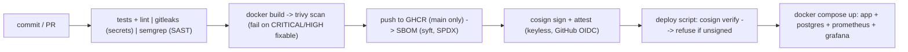
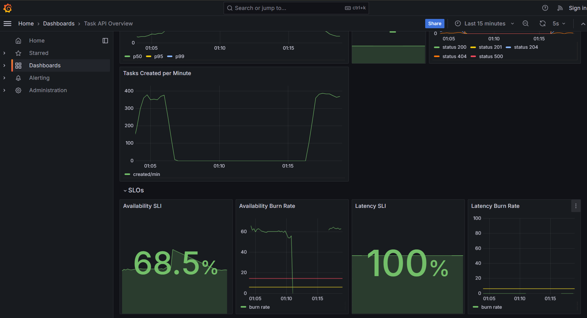
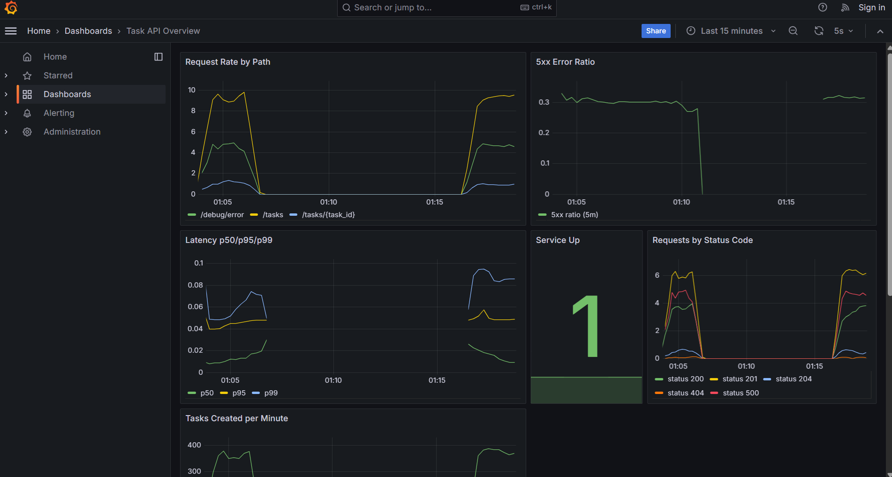
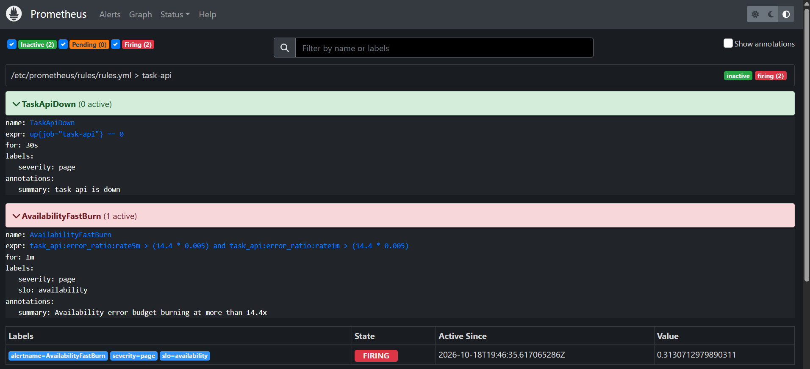
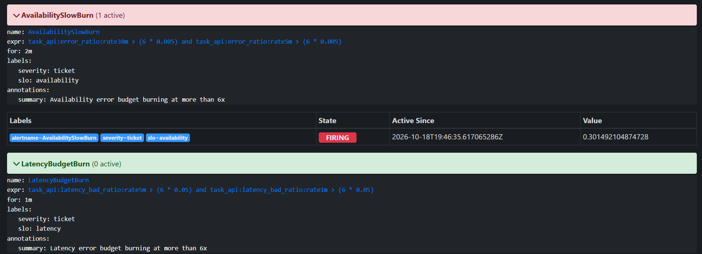
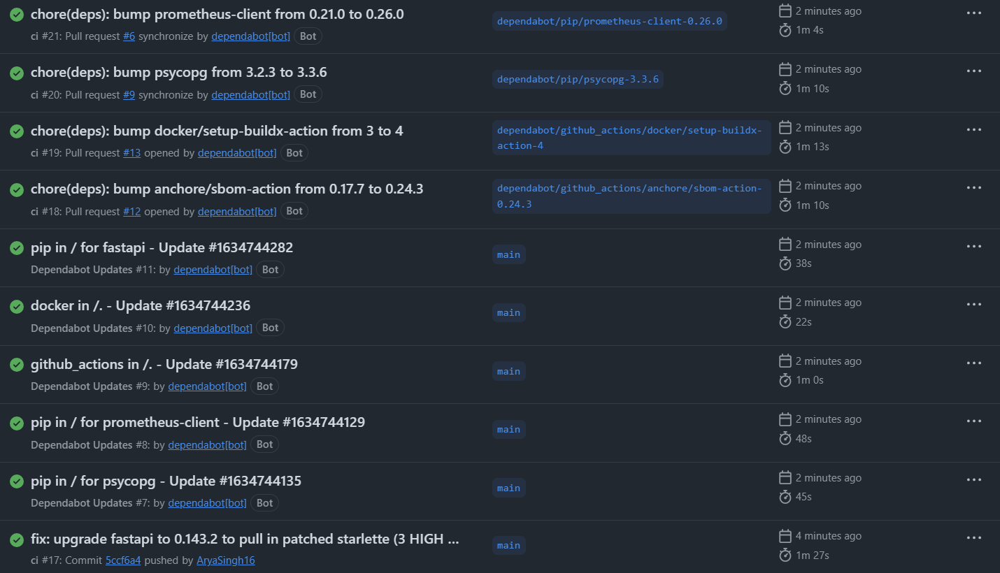
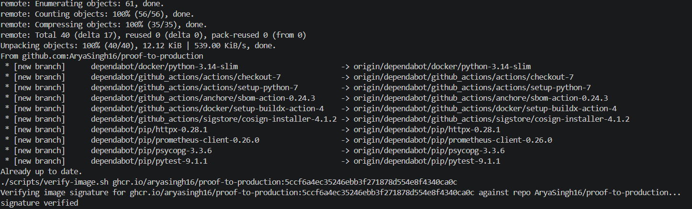
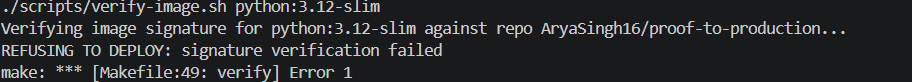
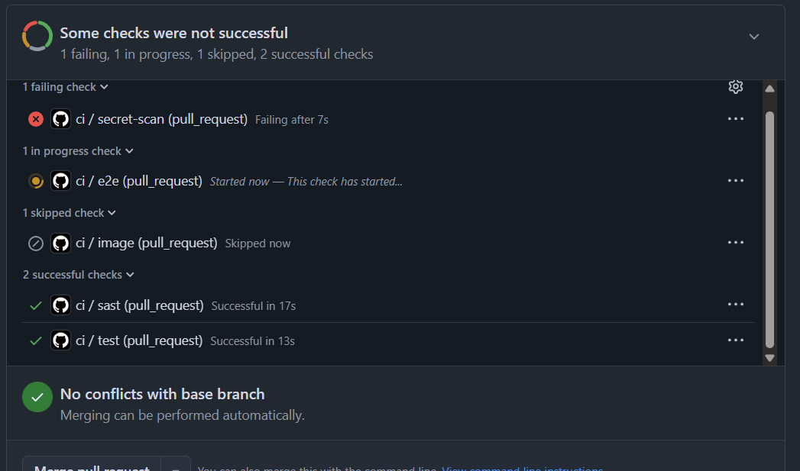

# proof-to-production

[](https://github.com/AryaSingh16/proof-to-production/actions/workflows/ci.yml)
[](LICENSE)

A small Task API (FastAPI + PostgreSQL) wrapped in a DevSecOps supply-chain pipeline on GitHub Actions: tests, secret scanning, SAST, image vulnerability scanning, an SBOM, and keyless Cosign signing, with images published to GHCR. A deploy script verifies the signature and refuses to run any image that was not signed by this repository's workflow. A Prometheus + Grafana stack adds SLO burn-rate alerting, and chaos scripts break the system on purpose to show alerts firing and the system recovering. Everything runs locally on Docker Compose; measured memory use was roughly 200-320 MiB for the whole stack.

---

## Supply-Chain Security & Observability Pipeline



---

## Quickstart

### Prerequisites
- Docker (with the Docker Compose v2 plugin)
- Make, curl, and python3

### 1. Launch the stack
```bash
make up
```
Services start and wait for their healthchecks:
- **Task API:** [http://localhost:8081](http://localhost:8081) (`/healthz`, `/readyz`, `/tasks`, `/metrics`)
- **Grafana:** [http://localhost:3000](http://localhost:3000) (`admin` / `admin`, anonymous viewer enabled)
- **Prometheus:** [http://localhost:9090](http://localhost:9090)

### 2. Run the smoke tests
```bash
make smoke
```

### 3. Check the memory footprint
```bash
make mem
```

### 4. Tear down
```bash
make down
```

---

## Live Demo & Chaos Script

1. **Start the stack:**
```bash
   make up
```

2. **Generate baseline traffic:**
```bash
   make loadgen
```
   Watch the **Task API Overview** dashboard in Grafana.

3. **Inject errors and trigger the SLO burn-rate alerts:**
```bash
   make chaos-errors
```
   This sends 30% HTTP 500 errors via `/debug/error` for 150 seconds. Watch **AvailabilityFastBurn** and **AvailabilitySlowBurn** fire at [http://localhost:9090/alerts](http://localhost:9090/alerts), and the SLO row in Grafana.

4. **Kill the database and check resilience:**
```bash
   make chaos-db
```
   While PostgreSQL is stopped, `/readyz` returns `503`. After it restarts, service recovers and the created tasks are still there (Docker named volume).

5. **Kill the app container:**
```bash
   make chaos-app
```
   See the Limitations section for what we actually measured here.

---

## Supply-Chain Verification Flow

The deploy script uses Cosign keyless verification against GitHub's OIDC identity. An image is accepted only if it was signed by this repository's `ci.yml` workflow on `main`.

### 1. Rejection demo (unsigned image)
```bash
REPO_SLUG=AryaSingh16/proof-to-production make verify IMAGE=python:3.12-slim
```
Expected output:
```text
Verifying image signature for python:3.12-slim against repo AryaSingh16/proof-to-production...
REFUSING TO DEPLOY: signature verification failed
```

### 2. Deploy a CI-built image
The image path must be lowercase, and the package must be set to public on GHCR. Use the full commit SHA of a commit that CI built on `main`:
```bash
REPO_SLUG=AryaSingh16/proof-to-production make deploy-verified IMAGE=ghcr.io/aryasingh16/proof-to-production:COMMIT_SHA
```

---

## Design Decisions

- **Route-template metric labels:** The metrics middleware records parameterized paths (`/tasks/{task_id}`) rather than raw URLs (`/tasks/123`), which prevents label-cardinality explosion in Prometheus. Unmatched paths fall back to `unmatched`. `/healthz`, `/readyz` and `/metrics` are excluded from traffic metrics.
- **Single uvicorn worker:** One worker process keeps memory low and avoids multi-process metric registry problems.
- **Synchronous database endpoints:** Task endpoints use plain `def`, so FastAPI runs the synchronous `psycopg_pool` queries in worker threads.
- **Healthchecks and dependency ordering:** `pg_isready` for the database, an in-container `/healthz` probe for the app, and HTTP readiness checks for Prometheus and Grafana, combined with `depends_on: condition: service_healthy`, give a deterministic startup order.
- **Container hardening:** The app runs as unprivileged uid 10001 with a read-only root filesystem, a `/tmp` tmpfs, all Linux capabilities dropped, and `no-new-privileges`.
- **Memory limits:** Compose enforces hard limits (app 128m, db 160m, Prometheus 192m, Grafana 192m) to keep the footprint small. Measured usage was about 200-320 MiB in total.
- **Keyless signing:** Short-lived GitHub OIDC identities are used for signing instead of long-lived private keys that could leak.
- **Exact identity pinning:** Verification matches the exact identity `https://github.com/AryaSingh16/proof-to-production/.github/workflows/ci.yml@refs/heads/main`, so images signed by other workflows, branches or repositories are rejected.
- **Multi-window, multi-burn-rate alerts:** Fast burn (14.4x) requires both the 5m and 1m windows to exceed the threshold; slow burn (6x) requires both the 30m and 5m windows. The long window shows the problem is real and the short window shows it is still happening, which reduces false alarms from brief spikes.
- Trivy blocked an early build because the pinned FastAPI pulled in vulnerable Starlette versions (3 HIGH CVEs). The fix was upgrading FastAPI, not suppressing the findings.
- Gitleaks scans the full git history. A narrow allowlist in .gitleaks.toml covers only the local demo Grafana credential admin:admin.

---

## Limitations

- CI runs on GitHub Actions and the pipeline is green. Actions are pinned by version tag, not commit SHA.
- **Verification is a deploy-time script, not an enforced policy.** Nothing stops someone from running an unsigned image directly with Docker. Real clusters enforce this with an admission controller (for example Kyverno or the Sigstore policy controller), which this project does not include.
- **Scaled-down alert windows.** Prometheus keeps 2 hours of data to fit the local memory budget, so the alert windows are shortened for the demo. Production would use 1h/5m for the 14.4x alert and 6h/30m for the 6x alert.
- **Demo credentials.** The PostgreSQL and Grafana passwords in `compose.yaml` are local placeholders and must be replaced with proper secret management in production.
- **Fault injection is enabled.** `ENABLE_FAULT_INJECTION=true` in the demo compose file exposes `/debug/error` and `/debug/slow`. These must be disabled in any real deployment.
- **No Kubernetes, Alertmanager or SLSA provenance.** The stack is plain Docker Compose. Alerts are visible in Prometheus but are not sent anywhere, and provenance attestations are not generated.
- **Actions are pinned by version tag, not commit SHA.** Pinning to SHAs would be stricter. Dependabot keeps the versions current.
- **Container kill recovery.** During chaos testing, a container killed with `docker compose kill app` was not restarted automatically by the Docker restart policy in this environment, so it had to be started manually with `docker compose up -d app`. The measured recovery time was about 49 seconds, including a 30-second wait.
- **Local scans.** `make scan` (Gitleaks and Trivy) needs the stack stopped (`make down`) on machines with limited RAM.

---

## Screenshots


*Task API Overview, SLOs row, during a chaos run with 30% injected errors. Availability SLI dropped to 68.5% and the burn rate sat far above the 6x and 14.4x threshold lines. Latency SLI stayed at 100%.*


*Request rate, 5xx error ratio, latency percentiles and status codes during the same run.*


*AvailabilityFastBurn in the firing state.*


*AvailabilitySlowBurn firing while LatencyBudgetBurn stays inactive.*

---

## Proof it works


*CI pipeline green on main.*


*Signature verified for the CI-built image.*


*An unsigned image is refused.*


*A pull request with a fake secret fails the secret-scan check.*
