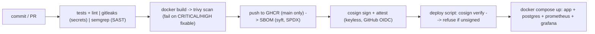

# DevSecOps Observability Pipeline

[](https://github.com/OWNER/REPO/actions)
[](LICENSE)

A production-grade, resource-constrained Task API (FastAPI + PostgreSQL) protected by an end-to-end DevSecOps software supply chain on GitHub Actions and monitored by a lightweight Prometheus + Grafana observability stack with multi-window SLO burn-rate alerting. The architecture enforces zero-trust deployment by cryptographically refusing to deploy any container image that lacks a verifiable Cosign keyless signature generated by GitHub Actions OIDC, while ensuring the entire runtime stack stays under 700 MiB of RAM.

---

## Supply-Chain Security & Observability Pipeline



---

## Quickstart

### Prerequisites
- Docker (with Docker Compose v2 plugin)
- Make, curl, and python3

### 1. Launch the Stack
```bash
make up
```
Services will initialize and wait for healthchecks:
- **Task API:** [http://localhost:8081](http://localhost:8081) (`/healthz`, `/readyz`, `/tasks`, `/metrics`)
- **Grafana Dashboard:** [http://localhost:3000](http://localhost:3000) (User/Pass: `admin`/`admin`, anonymous viewer enabled)
- **Prometheus UI:** [http://localhost:9090](http://localhost:9090)

### 2. Run Automated Smoke Tests
```bash
make smoke
```

### 3. Check Memory Footprint
```bash
make mem
```

### 4. Tear Down
```bash
make down
```

---

## Live Demo & Chaos Engineering Script

1. **Start the stack:**
   ```bash
   make up
   ```

2. **Generate Baseline Traffic:**
   ```bash
   make loadgen
   ```
   Inspect the Grafana dashboard at [http://localhost:3000](http://localhost:3000) under **Task API Overview**.

3. **Inject Errors & Trigger SLO Burn-Rate Alert:**
   ```bash
   make chaos-errors
   ```
   This generates 30% HTTP 500 errors via `/debug/error` over 150 seconds. Watch the **AvailabilityFastBurn** and **AvailabilitySlowBurn** alerts fire in Prometheus at [http://localhost:9090/alerts](http://localhost:9090/alerts) and observe the SLO row in Grafana.

4. **Kill Database & Verify Resilience:**
   ```bash
   make chaos-db
   ```
   Verifies that stopping PostgreSQL causes `/readyz` to return `503 Service Unavailable`, and that restarting PostgreSQL recovers service while preserving created tasks via Docker named volume persistence.

5. **Kill App Container & Observe Recovery:**
   ```bash
   make chaos-app
   ```

---

## Supply-Chain Verification Flow

The deployment script refuses to run unsigned or unauthorized images using Cosign keyless verification against GitHub OIDC:

### 1. Rejection Demo (Unsigned Image Refusal)
Test deployment rejection on an untrusted, unsigned image:
```bash
REPO_SLUG=OWNER/REPO make verify IMAGE=python:3.12-slim
```
*Expected Output:*
```text
Verifying image signature for python:3.12-slim against repo OWNER/REPO...
REFUSING TO DEPLOY: signature verification failed
```

### 2. Deploy Verified Image (CI-built)
Deploy an authentic image built and signed in GitHub Actions:
```bash
REPO_SLUG=OWNER/REPO make deploy-verified IMAGE=ghcr.io/OWNER/REPO:COMMIT_SHA
```

---

## Design Decisions

- **Route-Template Metric Labels:** Metric middleware records parameterized route paths (e.g. `/tasks/{task_id}`) instead of raw URLs (`/tasks/123`), preventing high-cardinality label explosion in Prometheus TSDB. Unmatched paths fall back to `"unmatched"`. Probes and metrics endpoints (`/healthz`, `/readyz`, `/metrics`) are excluded from traffic metrics.
- **Single Uvicorn Worker:** Runs with a single worker process inside the container to strictly adhere to memory limits and avoid multi-process metric registry fragmentation.
- **Synchronous Database Endpoints:** Task endpoints are defined with standard `def` rather than `async def`, allowing FastAPI to safely execute synchronous `psycopg_pool` queries on worker threads.
- **Healthchecks & Dependency Ordering:** Strict health checks (`pg_isready` for DB, urllib `/healthz` probe for app, HTTP ready probes for Prometheus and Grafana) coupled with `depends_on: {condition: service_healthy}` guarantee deterministic startup.
- **Container Hardening:** Containers run as an unprivileged user (`uid 10001`), with root filesystem set to `read_only: true`, a dedicated `/tmp` tmpfs mount, Linux capabilities dropped (`cap_drop: [ALL]`), and `no-new-privileges: true`.
- **Memory Limits:** Hard memory limits are enforced at the Compose level (`128m` app, `160m` db, `192m` prometheus, `192m` grafana) to remain stable within 700 MiB total WSL budget.
- **Keyless Signing (Sigstore / Cosign):** Uses ephemeral GitHub OIDC tokens for signing rather than long-lived private keys that risk exposure in secret stores.
- **Exact Identity Pinning:** Cosign verification binds explicitly to `https://github.com/OWNER/REPO/.github/workflows/ci.yml@refs/heads/main` to reject workflow or branch impersonation.
- **Multi-Window Multi-Burn-Rate Alerts:** Implements Google SRE multi-window alerting (1m/5m short and long windows for fast burn; 5m/30m for slow burn) to prevent false alerts on transient spikes while capturing sustained budget exhaustion.

---

## Limitations

- **CI Pipeline Execution:** The CI workflow defined in `.github/workflows/ci.yml` has been linted with `actionlint` locally, but has not yet been executed in a live GitHub Actions environment with actual GHCR and Sigstore OIDC credentials.
- **Scaled-Down Alert Windows:** Prometheus TSDB retention is set to 2 hours to fit the local WSL memory budget; alert windows are scaled down (5m/1m and 30m/5m) for demonstration purposes. Production environments should use 1h/5m for 14.4x fast burn and 6h/30m for 6x slow burn.
- **Placeholder Demo Credentials:** PostgreSQL passwords and Grafana admin passwords in `compose.yaml` are local development placeholders and must be replaced with secret management solutions in production.
- **No Kubernetes or Alertmanager:** The stack uses standalone Docker Compose; Alertmanager, notification webhooks, and distributed orchestration (K8s) are not included.
- **Docker Compose Kill Recovery:** During chaos testing, a container killed via `docker compose kill app` was not automatically brought back by the Docker restart policy in this environment, necessitating a manual restart command (`docker compose up -d app`); total measured recovery time was approximately 49 seconds (including a 30-second wait window).
- **Local Scans:** Local security scans (`gitleaks`, `trivy` via `make scan`) require stopping the running stack (`make down`) on machines with limited RAM.

---

## Screenshots

Placeholders for observability dashboards and alert statuses:
- Task API Overview Dashboard: `docs/img/grafana-dashboard.png` (placeholder)
- Prometheus SLO Burn-Rate Alerts: `docs/img/prometheus-alerts.png` (placeholder)

---

## Credits & Acknowledgements

Inspired by architectural and DevSecOps concepts from the open-source [Caesarsage/DevOps-Cloud-Projects](https://github.com/Caesarsage/DevOps-Cloud-Projects) repository.
