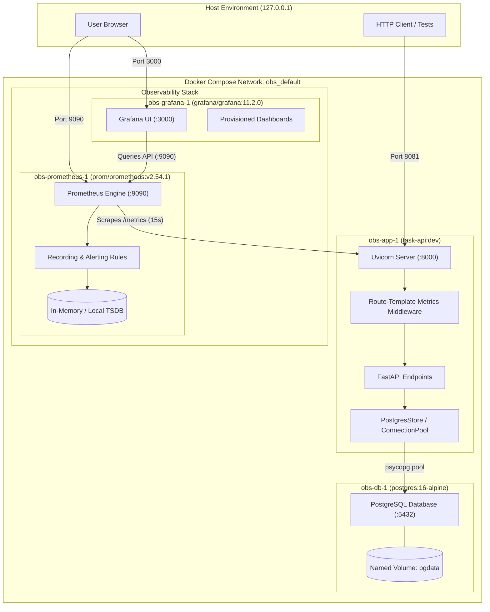

# System Architecture & Request / Data Flow

This document details the runtime architecture, request processing pipeline, and observability data flow.

---

## 1. Runtime Architecture

---

## 2. Request and Data Flow

### Request Flow
1. **Inbound Request:** The client connects to `127.0.0.1:8081` on the host, mapped to port 8000 inside `obs-app-1`.
2. **Metrics Middleware:**
   - Records request start timestamp (`time.perf_counter()`).
   - Bypasses metric recording for internal probe and scrape routes (`/metrics`, `/healthz`, `/readyz`).
   - Delegates request execution down the middleware stack to the matched FastAPI endpoint.
3. **Endpoint Execution:**
   - Declared with synchronous `def` signatures, allowing FastAPI to schedule execution on a background thread pool without stalling the asyncio event loop.
   - Interacts with PostgreSQL using `psycopg_pool.ConnectionPool` (1 to 4 connections) with `dict_row` mappings.
4. **Metrics Label Resolution:**
   - After `call_next` returns, the middleware reads the parameterized route template (e.g. `/tasks/{task_id}`) directly from `request.scope.get('route').path`.
   - If an unhandled route was called, it falls back to label `"unmatched"`, avoiding cardinality explosions.
   - Increments `http_requests_total{method, path, status}` and observes `http_request_duration_seconds{method, path}`.
   - If `call_next` raised an exception, records status `500` and re-raises.

### Observability Data Flow
1. **Prometheus Scraping:** Prometheus polls `http://app:8000/metrics` every 15 seconds.
2. **Rule Evaluation:** Prometheus evaluates recording rules (1m, 5m, 30m error ratios and latency breach ratios) and alerting rules every 15 seconds.
3. **Dashboard Visualization:** Grafana automatically provisions the `Task API Overview` dashboard via file provider from `/var/lib/grafana-dashboards` and proxies queries directly to Prometheus.

---

## 3. Container Resource Allocations & Hardening

| Container | Image | Memory Limit | Hardening Parameters |
|---|---|---|---|
| `obs-app-1` | `task-api:dev` (Python 3.12-slim) | 128 MiB | `read_only: true`, `tmpfs: [/tmp]`, `cap_drop: [ALL]`, `no-new-privileges: true`, `user: 10001` |
| `obs-db-1` | `postgres:16-alpine` | 160 MiB | `shared_buffers=32MB`, `max_connections=20` |
| `obs-prometheus-1` | `prom/prometheus:v2.54.1` | 192 MiB | Local TSDB retention 2h, read-only config mounts |
| `obs-grafana-1` | `grafana/grafana:11.2.0` | 192 MiB | Anonymous viewer access, telemetry disabled |
